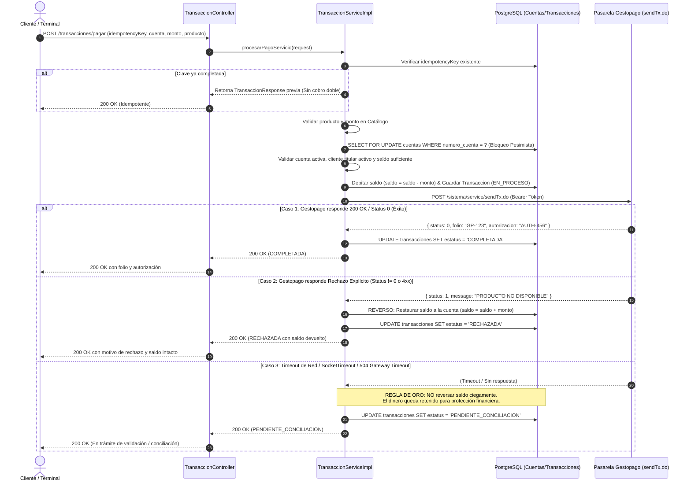

# Documentación Técnica: Integración de Pagos y Transacciones con Gestopago (`sendTx.do`)

## 1. Objetivo y Alcance
Desarrollar una integración financiera robusta, segura y transaccionalmente consistente con la pasarela de servicios **Gestopago** (`POST https://gestopago.portalventas.net/sistema/service/sendTx.do`). La solución no se limita al consumo del endpoint HTTP; abarca el ciclo de vida completo de la operación: validación de identidad y titularidad del cliente, verificación del catálogo y montos, control estricto de concurrencia e idempotencia, débito preventivo de saldo, tratamiento diferenciado de rechazos vs timeouts (sin asumir falsos negativos), y un mecanismo formal de **conciliación de operaciones**.

---

## 2. Análisis de Riesgos y Justificación de Decisiones de Diseño

En los sistemas financieros y transaccionales, las operaciones distribuidas entre una base de datos local y una pasarela externa conllevan riesgos críticos que fueron abordados mediante patrones arquitectónicos específicos:

| Riesgo Identificado | Impacto Financiero / Operativo | Solución / Decisión Técnica Implementada |
| :--- | :--- | :--- |
| **Condición de Carrera / Doble Gasto** | Dos solicitudes simultáneas podrían leer el mismo saldo y gastar más dinero del disponible. | **Bloqueo Pesimista (`@Lock(LockModeType.PESSIMISTIC_WRITE)`)** en `CuentaRepository.findByNumeroCuentaForUpdate`. Serializa a nivel de base de datos el acceso a la cuenta durante la transacción. |
| **Peticiones Duplicadas (Red o Usuario)** | Doble clic del cliente o reintento de red puede cobrar dos veces el mismo servicio. | **Idempotencia por Clave Única (`idempotencyKey`)**: Se almacena con restricción `UNIQUE` en la tabla `transacciones`. Si ya existe en estado `COMPLETADA`, se retorna la respuesta previa sin duplicar cargo ni reenviar a Gestopago. Si está `EN_PROCESO`, se rechaza con `409 Conflict`. |
| **Timeout o Incomunicación con Gestopago** | Una llamada que expira por timeout (HTTP 504 / SocketTimeout) **pudo haber sido procesada exitosamente por el proveedor**. Reversar el saldo ciegamente provocaría pérdidas financieras a la institución si el pago sí se aplicó. | **Estado `PENDIENTE_CONCILIACION`**: El saldo permanece retenido/debitado. No se asume fallo definitivo ni se reversa ciegamente. Se provee un endpoint de conciliación (`POST /transacciones/{folio}/conciliar`) para confirmar o reversar tras consultar al proveedor. |
| **Rechazo Explícito del Proveedor** | El proveedor responde con código de error (ej. producto agotado o parámetros inválidos). | **Reverso Automático Inmediato**: Se garantiza que el proveedor no cobró. El sistema restaura el saldo a la cuenta del cliente (`cuenta.saldo = cuenta.saldo + monto`) y marca la transacción como `RECHAZADA`. |
| **Manipulación de Montos o Productos Inexistentes** | Envío de importes manipulados o códigos no autorizados. | **Validación contra Catálogo Oficial**: Se valida la existencia y estado activo del producto con `ProductoService`. Si el catálogo estipula un precio fijo, se verifica que el monto coincida exactamente antes de cualquier débito. |
| **Fuga de Credenciales o Datos Sensibles** | Exposición de Bearer Tokens o datos de cuenta en logs o respuestas HTTP. | **Seguridad y Sanitización**: Token administrado por propiedad desacoplada (`gestopago.tx.token` / variable de entorno `GESTOPAGO_TX_TOKEN`). Nivel de logs Feign en `BASIC` y filtro Regex que enmascara `Bearer ***`, contraseñas y cuentas (`CTA-******7890`). |

---

## 3. Diagrama de Secuencia Transaccional



---

## 4. Estructura de la Base de Datos (PostgreSQL)

### Tabla `transacciones`
```sql
CREATE TABLE IF NOT EXISTS transacciones (
    id                          BIGSERIAL PRIMARY KEY,
    folio                       VARCHAR(36)     NOT NULL,
    idempotency_key             VARCHAR(100)    NOT NULL,
    cuenta_id                   BIGINT          NOT NULL,
    numero_cuenta               VARCHAR(20)     NOT NULL,
    cliente_id                  BIGINT          NOT NULL,
    id_servicio                 VARCHAR(50)     NOT NULL,
    id_producto                 VARCHAR(50)     NOT NULL,
    nombre_producto             VARCHAR(100),
    monto                       NUMERIC(15, 2)  NOT NULL CHECK (monto > 0),
    referencia                  VARCHAR(100)    NOT NULL,
    estatus                     VARCHAR(30)     NOT NULL,
    saldo_anterior              NUMERIC(15, 2)  NOT NULL,
    saldo_posterior             NUMERIC(15, 2)  NOT NULL,
    folio_proveedor             VARCHAR(100),
    autorizacion_proveedor      VARCHAR(100),
    mensaje_proveedor           VARCHAR(255),
    codigo_respuesta_proveedor  VARCHAR(50),
    motivo_falla                VARCHAR(255),
    fecha_creacion              TIMESTAMP       NOT NULL DEFAULT CURRENT_TIMESTAMP,
    fecha_actualizacion         TIMESTAMP       NOT NULL DEFAULT CURRENT_TIMESTAMP,
    CONSTRAINT uq_transacciones_folio UNIQUE (folio),
    CONSTRAINT uq_transacciones_idempotency UNIQUE (idempotency_key),
    CONSTRAINT fk_transacciones_cuenta FOREIGN KEY (cuenta_id) REFERENCES cuentas(id) ON DELETE RESTRICT,
    CONSTRAINT fk_transacciones_cliente FOREIGN KEY (cliente_id) REFERENCES clientes(id) ON DELETE RESTRICT
);
```

### Estados de Transacción (`EstatusTransaccion`):
1. **`INICIADA`**: Registro inicial de la intención de pago.
2. **`EN_PROCESO`**: Saldo debitado preventivamente, en comunicación con la pasarela.
3. **`COMPLETADA`**: Aprobada y confirmada exitosamente por Gestopago.
4. **`RECHAZADA`**: Rechazada por Gestopago, con **reverso automático de saldo** ejecutado.
5. **`REVERTIDA`**: Saldo restituido al cliente tras un proceso de conciliación.
6. **`PENDIENTE_CONCILIACION`**: Ocurrió un timeout o pérdida de comunicación. El saldo permanece congelado hasta resolución vía mesa de control o reintento de conciliación.

---

## 5. Endpoints de la API REST

| Método | Endpoint | Descripción | Códigos HTTP |
| :--- | :--- | :--- | :---: |
| `POST` | `/transacciones/pagar` | Ejecuta el flujo completo de pago de servicio / recarga con débito y validación de idempotencia. | 200, 400, 401, 404, 409, 422, 500 |
| `GET` | `/transacciones/{folio}` | Consulta el estado y detalle de una transacción por su folio UUID. | 200, 404 |
| `GET` | `/transacciones/cuenta/{numeroCuenta}` | Consulta el historial de transacciones cargadas a una cuenta bancaria. | 200 |
| `GET` | `/transacciones/cliente/{clienteId}` | Consulta el historial de transacciones pertenecientes a un cliente. | 200 |
| `POST` | `/transacciones/{folio}/conciliar` | Concilia una transacción en duda (`CONFIRMAR` si el proveedor la ejecutó, o `REVERSAR` saldo si no se aplicó). | 200, 400, 404 |

---

## 6. Verificación con Swagger UI

La aplicación expone la documentación interactiva en:
**`http://localhost:8081/swagger-ui/index.html`**

### Ejemplo de Solicitud para `POST /transacciones/pagar`:
```json
{
  "numeroCuenta": "CTA-1234567890",
  "clienteId": 1,
  "idServicio": "TELEFONIA",
  "idProducto": "PROD-01",
  "monto": 50.00,
  "referencia": "5512345678",
  "idempotencyKey": "TX-REQ-20261030-001"
}
```

### Ejemplo de Respuesta Exitosa (`200 OK`):
```json
{
  "folio": "550e8400-e29b-41d4-a716-446655440000",
  "idempotencyKey": "TX-REQ-20261030-001",
  "numeroCuenta": "CTA-******7890",
  "clienteId": 1,
  "idServicio": "TELEFONIA",
  "idProducto": "PROD-01",
  "nombreProducto": "Recarga Telefónica",
  "monto": 50.00,
  "referencia": "******5678",
  "estatus": "COMPLETADA",
  "saldoAnterior": 1000.00,
  "saldoPosterior": 950.00,
  "folioProveedor": "GP-999888",
  "autorizacionProveedor": "AUTH-123456",
  "mensaje": "TRANSACCION EXITOSA",
  "fechaHora": "2026-10-30 16:45:00"
}
```

### Ejemplo de Conciliación (`POST /transacciones/{folio}/conciliar`):
```json
{
  "accion": "REVERSAR",
  "observaciones": "El proveedor confirmó que la transacción no existe en su bitácora"
}
```

---

## 7. Evidencia de Pruebas Automatizadas

Se cuenta con **35 pruebas unitarias e integración pasando al 100%** bajo JUnit 5 y Mockito:

- **`TransaccionServiceImplTest` (15 pruebas)**:
  - Débito preventivo y aprobación exitosa por Gestopago.
  - Idempotencia: no reenvío ni doble cobro ante claves completadas.
  - Idempotencia: detección de transacciones en proceso (`409 Conflict`).
  - Validación de existencia y estatus activo de la cuenta bancaria.
  - Validación de titularidad: cliente autorizado para operar la cuenta.
  - Validación de cliente activo en la institución.
  - Validación de saldo suficiente (`SaldoInsuficienteException` / `422`).
  - Validación de restricciones de producto y monto en catálogo oficial.
  - Reverso automático inmediato ante rechazo del proveedor.
  - **Manejo de Timeout**: la transacción queda en `PENDIENTE_CONCILIACION` sin reversar saldo ciegamente.
  - Manejo de fallas de comunicación de red.
  - Conciliación manual `CONFIRMAR` (aprobación extemporánea).
  - Conciliación manual `REVERSAR` (reembolso del saldo retenido).
- **`TransaccionControllerTest` (7 pruebas)**:
  - Validación de códigos HTTP: `200 OK`, `400 Bad Request`, `404 Not Found`, `409 Conflict`, `422 Unprocessable Entity`.
- **`ProductoServiceImplTest` y `ProductoControllerTest` (13 pruebas)**:
  - Cobertura completa del catálogo de productos y manejo de errores HTTP externos.

### Comando para ejecutar pruebas:
```powershell
$env:JAVA_HOME = "C:\Users\marim\.jdks\ms-17.0.20.1"
.\gradlew.bat test
```
Resultados de ejecución:
```
BUILD SUCCESSFUL in 51s
5 actionable tasks: 3 executed, 2 up-to-date
Tests run: 35, Failures: 0, Errors: 0, Skipped: 0
```
